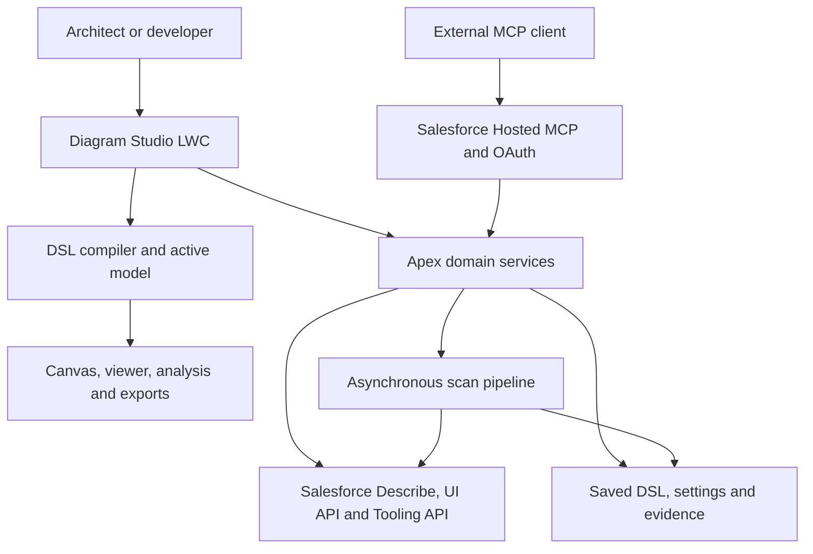
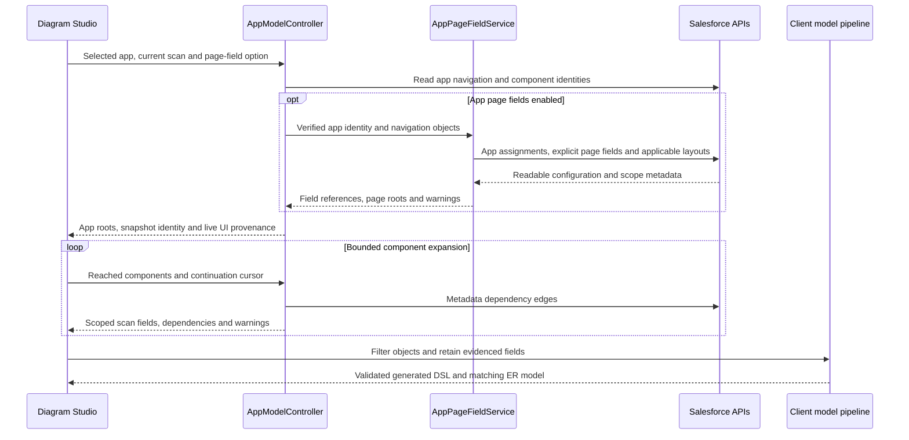
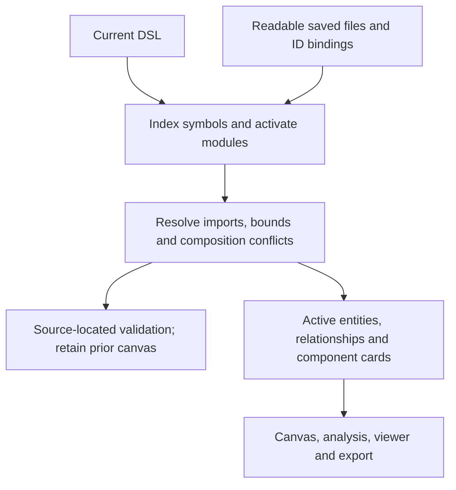
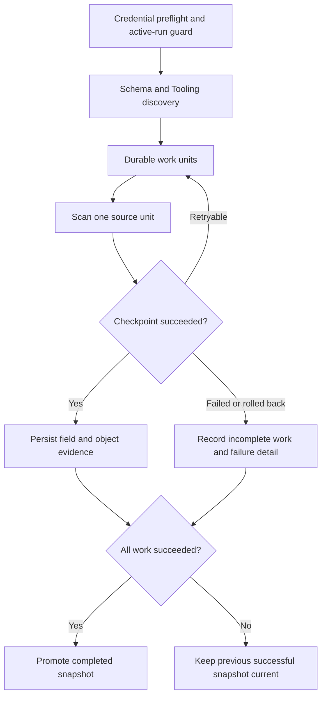

# Salesforce ER Modeller Studio V5 architecture

**Crius Consulting · Vikas Cohen, Lead Architect and System Designer · Updated: 8 November 2026**

This document describes the current `v5-Beta` source: visual modelling, the DSL compiler, app discovery, live page configuration, persisted scan evidence, analysis and optional Salesforce Hosted MCP. Installer **5.0.0.1** predates the new app-page field enhancement; it remains a separate, unpromoted beta build. See [setup](SETUP.md) and [validation](VALIDATION.md).

## System architecture

The application is native LWC/Apex. There is no application-owned external backend. Browser modelling and exports use the active model; metadata and source retrieval use Salesforce APIs. Optional external MCP clients are a separate authenticated access channel hosted by Salesforce.

| Responsibility | Current implementation |
| --- | --- |
| Editor, tabs, canvas and app generation | `diagramStudio` |
| Saved/imported file composition and completion index | `dslModules` |
| ER parser, semantic model and geometry | `erDiagramLogic` |
| App scope, strict field selection and component-card source | `appModelLogic` |
| App catalogue and bounded dependency expansion | `AppModelController` |
| Live assigned-page and navigation-layout fields | `AppPageFieldService` |
| Named permission-set/licence configuration | `AppAccessService` |
| Schema and relationship metadata | `SchemaMetadataController` |
| Saved files and readable import bindings | `DiagramFileController`, `DslFileService`, `DiagramFileNames` trigger |
| Dictionary and architecture views | `dataDictionaryFieldDetail`, `architectureIntelligence`, `objectArchitectureHealth` |
| Scan operation and evidence views | `FieldUsageOrchestrator`, discovery/worker/finalizer classes, `fieldUsageSettings`, `fieldUsageIntelligence` |
| Diagnostics and optional MCP | `ErStudioDiagnosticService`, diagnostic controllers, `ErMcpCore` and four invocable tools |

## App model generation and field evidence

Salesforce app mode starts with UI API navigation and resolved application identity. Standalone LWC/Aura mode starts from one verified bundle. Both traverse reached static dependencies and reuse a successful V5 snapshot; neither means every org component belongs to the selected app.

### Page-configuration source

`AppPageFieldService` adds a second evidence source when **Include fields configured on app pages** is enabled:

- Read explicit `Record.FieldName` items from app-assigned Lightning record pages and Dynamic Forms, restricted to navigation-object context.
- A readable `force:recordDetail` component can contribute its profile layout.
- Applicable navigation layouts come from UI API in **View/Large** mode, using the Tooling API principal and its default record type. These layouts can be shared across apps. The result describes readable configuration, not actual execution or app-exclusive field usage.
- An unreadable/unknown app assignment does not justify substituting an unrelated default layout. Unsupported layouts become coverage warnings. Ambiguous identities, malformed contexts and configured bounds fail before a new model is created.
- Only recognised field nodes are evidence; labels, arbitrary strings and all fields from object-info/schema are not. Field identifiers are verified against readable schema.

Page fields are read **live during generation**, not written into an earlier scan snapshot. Their provenance records page/layout, object, principal/default-record-type scope and read time. Component scan evidence retains its own snapshot identity. The new option is hidden in standalone component mode; disabling it preserves component-only generation.

### Selection and output

`collectAppScope` merges page and component field references. `selectAppObjects` removes known platform/security/presentation dependencies and Salesforce file tables (`ContentDocument`, `ContentVersion`, `ContentDocumentLink`) from generated models only. Drag/search remains independent and does not hide these objects. `prepareAppSchema` retains evidenced fields only; `Id` remains structural. No missing-evidence fallback expands an entity to its whole schema.

The production `buildErSource` output is parsed before a new tab replaces editor/canvas state. Failed discovery preserves current work. Generated comments and Model Details retain evidence and warnings. Existing source is not silently regenerated when metadata changes.

App traversal is bounded to 2,000 components and 150 expansion requests, with batches of 40. Page discovery allows up to 25 navigation objects, 20 assigned pages, 2,000 field references, 30 nesting levels and 500,000 characters per metadata response. These limits are checked in code; no truncated result is presented as complete.

### Named component and access cards

Apex/Flow cards preserve component identity. App access discovery follows explicit app visibility/reached Apex grants to non-profile permission sets, then actual licence/package references. It does not infer mandatory user assignments, list every org licence, or turn PermissionSet/UserLicense tables into ER entities. Profiles, permission-set groups and indirect feature-licence routes are outside this initial discovery.

Cards are typed DSL declarations with optional JSON labels. They have no schema fields, do not participate in sharing/heatmap calculations, and occupy a separate fitted section. Standalone component mode currently disables app access discovery. See [Compiler.md](../Compiler.md) for all six card types.

## Compiler, imports and persistence

`export module` bodies are inert until `use` activates them. Imported top-level models are not automatically drawn. `extends` adds the exported base before the child. Plain DSL remains valid. Conflicting activated field/relationship definitions and card labels fail rather than silently override.

Canonical filenames are unique across the org, ignoring case and the optional `.dsl` suffix; paths are not accepted. Saved imports bind to record IDs and resolve readable, latest-saved source across renames. Imports are not version-pinned. `DslFileService` uses user-mode reads for the import boundary.

Composition is limited to 32 files including the root, 16 import levels and 1,048,576 source characters. The client compiler reports cycles and preserves source filenames/line numbers. The completion index tolerates unfinished text. Current inline authoring validation is separate from persisted operation history. Shared entity/field edits belong in the DSL; modular-file canvas schema reconciliation is guarded.

Full syntax, examples and implementation links are in [Compiler.md](../Compiler.md).

## Scanner lifecycle

`FieldUsageOrchestrator` preflights the Named Credential before DML, prevents overlapping active scans and persists the Salesforce job identity. Schema discovery and Tooling discovery create bounded work. Workers checkpoint results, retry caught failures up to their attempt limit, and record platform transaction rollbacks at finalisation. Partial/failed runs do not become the current successful snapshot.

Field and object evidence are separate: field references support impact/field scope, while object/component edges support dependency traversal. Apex classes and LWC/Aura bundles are isolated per work unit to reduce cumulative governor exposure. LWC object/import/tag and Omni UI matching locate literal candidates before anchored expressions, avoiding full-source regex searches on large Studio files.

The optional standard OmniStudio scanner probes object/field availability before querying configuration with validated identifiers and bound values in user mode. Missing capabilities skip safely; configured SOQL text is never executed. Managed-source/dynamic references and Data Cloud DMO/DLO discovery are not converted into guessed evidence. Page layouts are read on demand rather than stored as org-wide scan rows.

## Stored state

| Store | Purpose |
| --- | --- |
| `Diagram_File__c` | Source DSL, unique filename key, import-binding JSON and model presentation state |
| `Diagram_Studio_Pref__c` | Studio preferences |
| `Field_Usage_Run__c` | Snapshot identity, status, progress, errors and scan version |
| `Field_Usage_Work_Unit__c` | Temporary durable source work and retry state |
| `Field_Usage_Evidence__c` | Field-level reference evidence linked to a run |
| `Object_Usage_Evidence__c` | Object/component dependency edges linked to a run |
| `Field_Usage_Schedule__c` | Scan schedule configuration |
| `MCP_Settings__c` | Hosted MCP action switches and cooldown |
| `ER_Diagnostic_Config__c` | Opt-in mapping to an existing diagnostic object |

Run evidence/work units relate to their run; import record IDs live in binding JSON, not an invented schema relationship. Live page fields are returned to the client and can be represented in generated source/provenance, not inserted as a new scan history. Small org storage limits can still constrain snapshot volume and retention.

## Canvas and intelligence

The renderer uses one active semantic model, with typed objects and component cards kept separate. Fit Model groups objects, platform events, custom metadata, Apex/Flow and access cards. Layout geometry preserves declared relationship type and direction; it does not derive master-detail from line position or colour alone.

Data Dictionary reads schema/metadata details. Architecture Intelligence and Relationship Insights derive structural findings from the selected model and available evidence. Heatmap and sharing consumers skip non-schema cards; event/metadata sharing and event counts are marked N/A where inapplicable. These views inform review rather than certify that deleting a record or field is safe.

## Security, diagnostics and MCP

The target org owns Tooling API authentication and External Credential principal access. The running-user and configured-principal boundaries are distinct. File imports enforce readable records/fields; page evidence names the principal/default context. Dynamic identifiers and cursors are validated before API requests. Secrets are not packaged or written into DSL/evidence.

Operational errors use Studio-scoped session diagnostics and optional best-effort persistence to an administrator-selected existing object. Persisted records are inserted in user mode and can be lost with transaction rollback. Durable run/work checkpoints and Salesforce job logs complement diagnostic history. Temporary typing validation is not a persisted operation event.

Salesforce Hosted MCP exposes four tools: snapshot status, field usage, changed fields and scan initiation. Salesforce owns transport, OAuth and server activation; the app owns action permissions, switches, snapshot pagination and cooldown. MCP client authentication is separate from the outbound `Salesforce_Tooling_API` credential.

See [security](SECURITY.md), [setup](SETUP.md) and [current validation](VALIDATION.md). The source implementation and the installed package version must be assessed separately.
