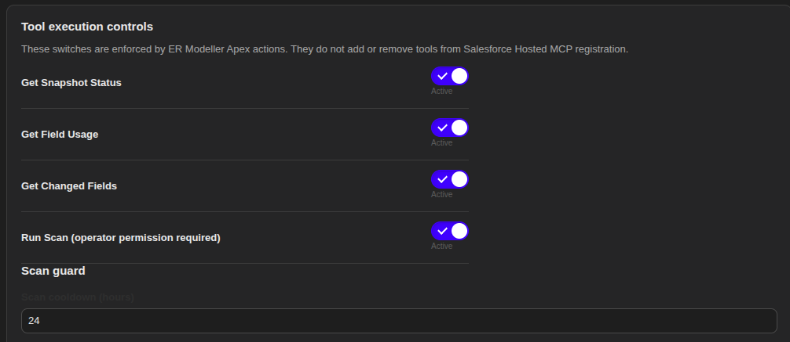
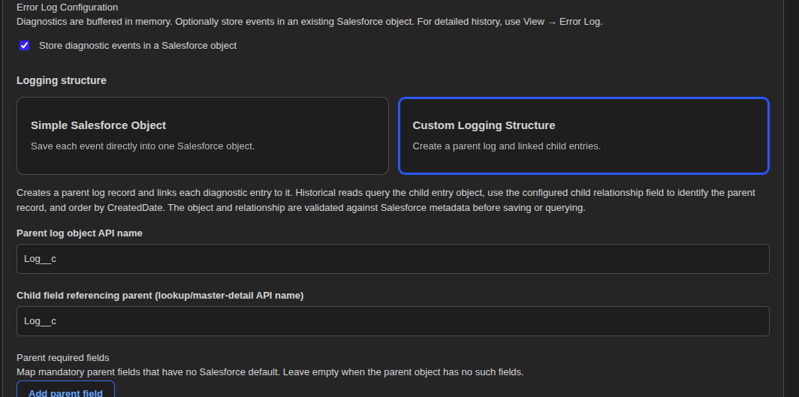
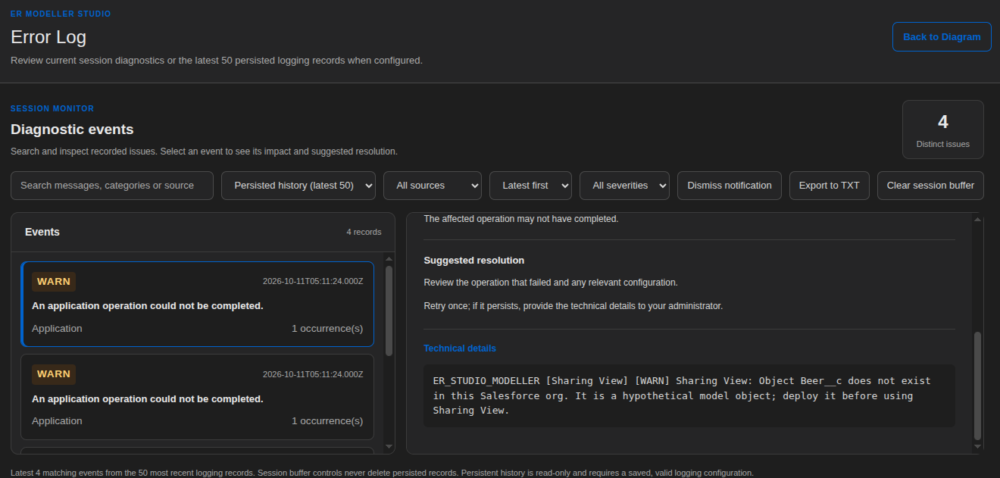

# V4 administrator guide: Salesforce Hosted MCP

> **Latest V4 source:** `main` and `V4-latest` (20 October 2026). The screenshots below are development-environment UI examples, not production acceptance evidence. Do not publish org-specific URLs, OAuth secrets or tokens.

## 1. What ER Modeller MCP provides

ER Modeller Studio V4 uses **Salesforce Hosted MCP**. Salesforce hosts the protocol endpoint and handles server registration; ER Modeller contributes four Apex invocable actions. No standalone Node.js or custom Linux MCP service is needed. The actions expose **persisted Field Usage intelligence**, not arbitrary Salesforce record operations. They cannot guarantee a schema change is safe.

| Registered tool | Action class | Behaviour |
| --- | --- | --- |
| `ErMcpGetSnapshotStatus` | `ErMcpGetSnapshotStatus` | Read stored snapshot status and active scan state without scanning. |
| `ErMcpGetFieldUsage` | `ErMcpGetFieldUsage` | Read field references and provenance with bounded pagination. |
| `ErMcpGetChangedFields` | `ErMcpGetChangedFields` | Compare evidence across up to five successful snapshots; 40,000-evidence-row synchronous limit. |
| `ErMcpRunScan` | `ErMcpRunScan` | Queue an asynchronous Field Usage scan, subject to operator access, concurrency and cooldown. |

## 2. Register and activate the server

1. Deploy V4 metadata and Apex to an authorised Salesforce org. Assign `Diagram_Studio_User` only to trusted administrators/operators; verify effective permissions separately for integration users.
2. In **Salesforce Setup**, search **MCP Servers**. Under **Integrations → API Catalog → MCP Servers → Salesforce Servers**, choose **Add MCP Server**, select the custom-server option and provide a descriptive server name, for example **ER Modeller Studio**. Salesforce's available setup labels can vary by release.
3. Register the four ER Modeller Apex invocable actions above as tools. Verify each description and action mapping under the server's **Tools** tab. Do not accidentally add unrelated generic record-access tools.
4. Activate the server. The server list should show **Active** and **4 tools**. Under **Einstein → Agentforce Registry → Registered MCP Servers**, confirm the registration and tool list; these are separate Salesforce Setup views.
5. Open the server's **Details → Authentication Details** and copy the **Server URL** shown by Salesforce. Do not construct the URL from a guessed pattern.

**Observed in the supplied screenshots (20 October 2026):** The custom **ER Modeller Studio** server is **Active**, with **4 tools**, and Agentforce Registry lists it as **Active**. The four tool names are visible. This establishes registration/activation in the pictured developer org, not successful authentication from every external client.

## 3. Connect an external MCP client

1. In Salesforce, configure an **External Client App** for the calling application, with supported OAuth authorisation and the `mcp_api` scope, as required by the Salesforce Hosted MCP release in use.
2. Grant the integration identity the required Salesforce and ER Modeller permissions. Restrict **Run Scan** to approved operators.
3. In the MCP client, use the exact Salesforce-provided **Server URL** and the OAuth flow supported by that client. Never place access tokens or client secrets in screenshots, README files or commits.
4. Confirm authenticated **tool discovery** (`tools/list`), then invoke **Get Snapshot Status** (`tools/call`). Compare the returned snapshot with **Studio → Settings → Field Usage**. Next test **Get Field Usage**, **Get Changed Fields**, and finally **Run Scan**.
5. The outbound `Salesforce_Tooling_API` Named/External Credential used by the Field Usage scanner is **not** the external client's OAuth credential.

**Acceptance status:** A prior MCP Run Scan invocation returned `Scan cooldown has not elapsed.` That confirms an application-level response was observed, but the complete OAuth, discovery, read-tool and successful MCP scan matrix has not been independently documented as passed.

## 4. Configure Studio MCP controls

Go to **ER Modeller Studio → Settings → MCP Server**. The four switches enable or disable execution **inside ER Modeller Apex**. They do **not** register or remove Salesforce Hosted MCP tools. The **MCP scan cooldown** field is measured in hours: `0` disables the waiting period for testing, `24` waits one day after the latest completed scan, and accepted values range from `0` to `8760`. Manual scans also reset the timer. Click **Save settings**. Restore a sensible nonzero cooldown after integration testing.

*Figure 1. MCP tool execution controls in ER Modeller Studio. Switches affect Apex execution, not Salesforce server registration.*

## 5. Configure Apex exclusions and run scans

Go to **Settings → Field Usage → Apex Class Exclusions**. Enter an exact class name, click **+ Add Class**, repeat as needed, then **Save Exclusions**. Remove individual entries with **Remove**, then save again. Exclusions are applied at discovery time to future scans, whether started manually or through MCP. The initial four Nebula Logger exclusions are `Logger`, `Logger_Tests`, `LogEntryEventBuilder_Tests`, `LogEntryEventHandler_Tests`. These are **exact names**, not wildcard/namespace patterns. Other application classes calling Logger are still eligible for scanning.

The screenshot of **Last 10 Scans** shows a manual scan on 20 October 2026 from **12:20:52 to 12:38:22**, status **Completed**, **1,756 dependencies** and **0 errors**. Earlier scans had errors; their historical records are retained. This demonstrates a successful manual scan, not yet a successful MCP-initiated scan.

## 6. Diagnostics and last five MCP calls

- **Settings → Diagnostics** runs the application health check. Merely opening the page does not run it.
- **Settings → Error Log Configuration** controls optional diagnostic persistence in an **existing Salesforce object**. Enable **Store diagnostic events in a Salesforce object** and configure a supported simple-object mapping or custom parent/child logging structure. Validate actual object and field API names, required fields, CRUD/FLS and save. Example names shown in screenshots (`Log__c`, `LogEntry__c`, `Message__c`) are configuration examples, **not proof those objects exist or are accessible**.
- **Settings → MCP Server → Last 5 MCP calls** queries only the five newest persisted MCP-prefixed entries. If it displays **MCP call history is not enabled / No accessible diagnostic log object**, the configured destination is missing, invalid or inaccessible; **Refresh calls** cannot create historical records. Enable and validate logging, invoke a new MCP tool, then refresh.

*Figure 2. Example configuration for optional Salesforce-object diagnostic logging. The pictured API names are examples, not installation defaults.*

- **View → Error Log** distinguishes **Session events** (browser-session buffer) from **Persisted history (latest 50)**. Filters such as **MCP errors** restrict what is displayed. **Clear session buffer** does not delete persisted Salesforce records. The pictured historical errors include `ER_STUDIO_MODELLER_MCP [HOSTED_MCP / Tool invocation] tool=Run Scan; outcome=Error`; these do not establish a failure of the latest healthy manual scan.

*Figure 3. Error Log explorer with persisted history, filters and event details. Entries are examples and are not evidence of a current V4 package failure.*

- Persistence is best-effort and subject to permissions, validation and transaction rollback. It is not an immutable audit trail.

## 7. Troubleshooting

| Symptom | Meaning / next action |
| --- | --- |
| `Scan cooldown has not elapsed.` | A completed scan is too recent. Read the current snapshot, wait, or temporarily set cooldown to `0` for controlled testing. |
| Scan already running | Wait for the active asynchronous scan; do not queue a duplicate. |
| Tool disabled | Enable that tool in **Settings → MCP Server**, then save; Salesforce registration alone does not override this control. |
| Permission denied | Check the integration user's permissions and scan-operator custom permission, not just the admin's profile. |
| MCP server missing / no tools | Check Salesforce **MCP Servers** and **Agentforce Registry**; ensure server activation and four action registrations. |
| OAuth / connection error | Verify exact server URL, External Client App, `mcp_api` scope, user access and client-specific OAuth flow. |
| Last 5 MCP calls empty | Configure an accessible logging destination, save, make a new invocation, then refresh. |
| Historic errors visible despite healthy scan | Check timestamps and scan IDs. Persisted errors remain visible after a later successful scan. |
| Scanner CPU / regex errors | Inspect **Field Usage → Last 10 Scans** and diagnostics; exclude unusually large third-party Apex classes where appropriate. |

## 8. Acceptance checklist

- [x] Salesforce custom Hosted MCP server active and four tools visible in supplied developer-org screenshots.
- [x] Agentforce Registry entry active in supplied screenshots.
- [x] Manual Field Usage scan completed with 0 errors on 20 October 2026.
- [x] Apex exclusion manager visible with four default entries.
- [ ] Documented authenticated `tools/list` response from external client.
- [ ] Successful external read-tool calls validated against persisted snapshot data.
- [ ] Successful MCP-triggered scan with exclusions and 0 errors.
- [ ] Negative permission tests with a separate integration identity.
- [ ] Persisted MCP call history verified against a configured accessible log destination.

For deeper implementation details, see [V4 MCP setup](V4_MCP_SETUP.md), [V4 requirements](V4_REQUIREMENTS.md) and [diagnostic coverage](DIAGNOSTIC_COVERAGE.md). For Salesforce platform specifics, consult [Salesforce Hosted MCP custom-server documentation](https://developer.salesforce.com/docs/platform/hosted-mcp-servers/guide/custom-servers.html).
